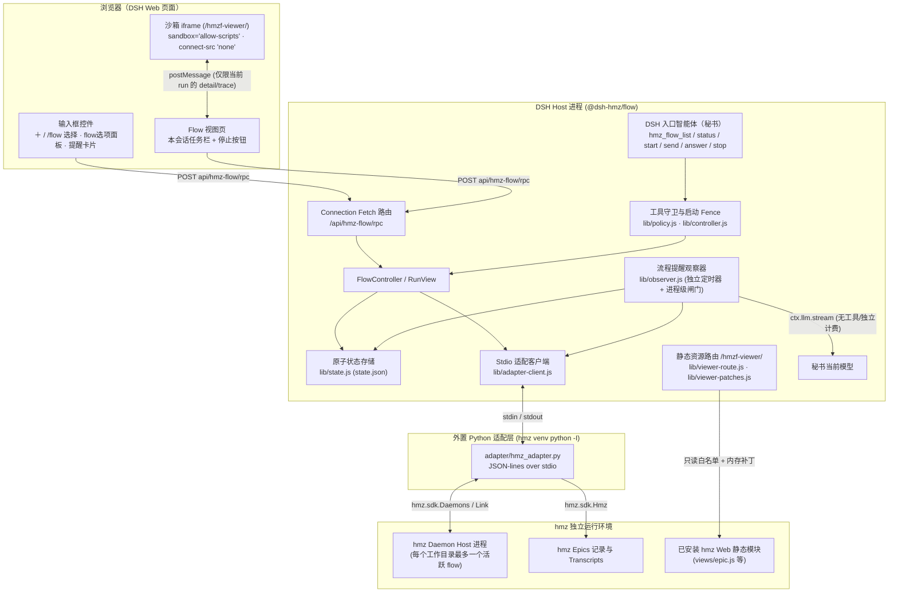

# 架构与设计边界

本文档说明 `@dsh-hmz/flow` 的模块分层、进程与会话所有权模型、写保护机制、Flow 页原生渲染沙箱，以及流程提醒（旁路观察）的设计与技术边界。

---

## 1. 整体架构与非侵入原则

`@dsh-hmz/flow`（位于 [`packages/dsh-hmz-flow/`](../packages/dsh-hmz-flow/)）是一个外置 DSH 插件与外置 Python 适配层组合。**已安装的 DSH 与 `hmz` 源码均未作任何修改**，双方仅通过公开接口衔接：

- **DSH 公开插件接口**：
  - Host 端（[`index.js`](../packages/dsh-hmz-flow/index.js)）：`tools`（`register`、`guard`、`presentAs`）、`agents`（`roots`、`isOwnedBy`、`followup`、`withoutInitiator`）、`connection.fetch`、`webServer`、`workingDirectory`、`userQuestions`、`llm`（`listModels`、`stream`）、`systemPrompt.context`。
  - Client 端（[`client.js`](../packages/dsh-hmz-flow/client.js)）：`slots`（`conversation.input.left`、`conversation.input.dock`、`conversation.view`）、`locale`、`inputTriggers`（`/` 菜单源）、`commandUi`（`＋` 菜单 `/flow` 指令与 `dismiss`）、`sessions`。
- **`hmz` 公开 SDK 与 Web 模块**：
  - Python 适配层（[`adapter/hmz_adapter.py`](../packages/dsh-hmz-flow/adapter/hmz_adapter.py)）：通过 `hmz.sdk.Hmz`、`hmz.sdk.Daemons`、daemon `Link`、`hmz.web.flows.declared` 与 `hmz.web.runs`（`detail`、`calls`）读写状态与执行控制。
  - 前端视图复用：直接按需读取已安装 `hmz` 包内的 `hmz/web/static` 静态模块，无需启动独立的 `hmz web` 服务进程。

---

## 2. 会话归属、状态存储与独立生命周期

### 2.1 以 DSH `sessionId` 为唯一归属键

- 插件的持久化文件 `state.json`（[`lib/state.js`](../packages/dsh-hmz-flow/lib/state.js)，当前 schema `VERSION = 3`）以 **DSH 会话 ID（`sessionId`）**作为所有权主键，**绝不按工作目录（cwd）推断任务归属**。
- 同一工作目录下新建的另一个 DSH 会话：
  - 打开 Flow 页时显示空白/就绪状态，不会自动发起任何 `hmz` 调用，也不会列出或接管同目录下其他会话启动的 epic。
  - 若尝试在 RPC（如 `runTree`、`runSession`、`viewDetail`、`viewTrace`、`stopRun`、`observerGet`、`observerAct`）中传入其他会话的 `runId`，[`lib/runview.js`](../packages/dsh-hmz-flow/lib/runview.js) 会在调用适配层之前直接拦截并返回 HTTP `403`。
- 每个会话的 `runs` 历史记录只追加不覆盖（append-only），最多维护一个当前活跃绑定（`binding`）。秘书的 `send`、`answer`、`stop` 始终作用于本会话的当前 `binding`。

### 2.2 原子持久化与原型污染防护

- `StateStore` 对所有状态变更先在无原型对象（`Object.create(null)`）深拷贝副本上暂存，再通过**写入临时文件 → `fsync` → 原子 `rename` → 目录 `fsync`** 落盘，最后更新内存引用。写盘失败不会污染内存中的可见状态。
- 会话 ID、flow 名称与 `runId` 均经过正则校验；会话 ID 与状态对象的键还会过滤 `__proto__`、`constructor` 等保留键。

### 2.3 进程解耦与精确 Run 身份（Identity）

- **独立存活**：`hmz` 任务运行在独立的 `hmz` daemon host 进程中。关闭浏览器标签页、重载插件或重启 DSH Host 进程，都不会中断正在执行的 flow；DSH 重启后会通过 `state.json` 自动重新接回该 run 并恢复写保护与完成通知投递。
- **取消回复 ≠ 停止任务**：
  - 在 `hmz_flow_start` 发出启动请求**之前**（读取 flow 声明后、进入会话串行队列后），如果工具调用的 `exec.signal` 已被取消（用户点击了停止回复），控制器不会发出启动请求。
  - 一旦 `hmz` 已经接受启动，后续取消秘书的回复不会停止 `hmz` 中的 flow。
- **精确身份核对**：每个绑定的 run 由四元组唯一标识：`{ hostPid, hostStarted, run, epic }`（外加启动请求 `requestId`）。
  - 每次执行 `say`、`answer`、`stop` 时，Host 与适配层都会核对该四元组。
  - 用户在 Flow 页查看历史 run 时，或者页面展示的 run 在点击前已被替换时，点击停止按钮会因身份不匹配而被安全拒绝，绝不会误停新的当前 run。

---

## 3. 启动前检查（Quiescence Fence）与运行期写保护

详细实现位于 [`lib/controller.js`](../packages/dsh-hmz-flow/lib/controller.js) 与 [`lib/policy.js`](../packages/dsh-hmz-flow/lib/policy.js)。

### 3.1 串行控制与启动前静默检查

每个 DSH 会话的控制命令通过 Promise 链严格串行执行。当秘书调用 `hmz_flow_start` 时：

1. **禁止从 `run_code` 内部嵌套启动**：若 `exec.parent !== undefined`，直接拒绝启动（因为外层 `run_code` 程序在启动后仍可继续直接操作文件系统）。
2. **同步开启启动 Fence**：将 `sessionId` 加入 `fencing` 集合，立即激活该会话代理树的 `ctx.tools.guard` 写保护，阻止新的写入调用进入。
3. **静默检查（Quiescence Check）**：遍历当前根会话拥有的整棵代理树（通过公开的 `ctx.agents.isOwnedBy` 传递闭包计算），检查是否存在：
   - 仍在运行的子代理（`subagent.status === 'running'`）
   - 仍在运行或停止中的后台作业（`job.status === 'running' | 'stopping'`）
   - 正在执行中的非只读工具调用（排除本次 `hmz_flow_start` 自身 token）
   - **若有任何一项仍在运行，立即拒绝启动并释放 Fence，绝不强行终止用户已有的后台任务。**
4. **先持久化意图再发送请求**：生成唯一 `requestId`，将 `phase: 'starting'` 写入 `state.json` 后再调用适配层 `start`。

### 3.2 白名单写保护与原生工具呈现

- **触发时机**：仅当会话处于启动 Fence 期间，或绑定 run 的 `phase` 为 `starting`、`running`、`stopping`、`unknown` 时生效。**仅在界面选中 flow 但尚未启动任务时，不施加任何写限制。**
- **白名单机制（Allowlist）**：受保护期间，本会话及其所有子代理在 `ctx.tools.guard` 阶段按工具名白名单放行：
  - 允许：`hmz_flow_list`、`hmz_flow_status`、`hmz_flow_send`、`hmz_flow_answer`、`hmz_flow_stop`、`read`、`read_image`、`glob`、`grep`、`lsp`、`web_search`、`web_fetch`、`ask_user_question`、`todo_write`、`get_goal`、`skill`、`job_list`、`job_output`、`list_agents`、`list_subagent_models`、`session_event_read`、`session_event_search`、`session_event_trace`、`session_search`、`session_trace`、`terminal_list`、`terminal_read`、`cordis_inspect_list`、`cordis_inspect_query`。
  - 拒绝：一切不在白名单中的工具（如 `bash`、`write`、`edit`、`subagent`、`workflow`、未知 MCP 工具等），以及模型直接调用的顶层 `run_code`（若从 `run_code` 内部发起 PTC 子调用，会重新进入 guard 并按子调用工具名判定）。
- **原生工具呈现（`presentAs('native')`）**：当会话选中了 flow 或处于写保护状态时，插件调用 `agent.ctx.tools.presentAs('native')`，确保即使在默认使用 PTC（`run_code`）呈现的环境中，秘书依然能够直接作为原生工具调用 `hmz_flow_*` 与只读工具。

### 3.3 诚实的结果分类与对账

适配层客户端（[`lib/adapter-client.js`](../packages/dsh-hmz-flow/lib/adapter-client.js)）将所有异常严格区分为三类，且**绝不在适配层自动重试**：

- `not-sent`：适配层进程未启动或标准输入不可写，请求字节未发出。
- `refused`：适配层或 `hmz` 明确拒绝（如目录已有活跃 flow、存在未关闭的原生 `hmz chat` host、角色未配置、预算缺失等）。启动失败会清除 `starting` 意图并解除保护。
- `unknown`：请求可能已写出但未收到响应（如超时、管道断裂、子进程退出，或 `hmz` 已接受但本地写盘失败）。此时 `phase` 保持或转为 `unknown`，写保护继续维持，后续仅通过 `find_request` 按前端标识 `dsh-hmz-flow:<requestId>` 进行只读对账。

同样，`stop` 被 `hmz` 接受后仅进入 `stopping` 阶段；必须等到原 daemon host 不再持有该 run，**且** `hmz` 的 epic 记录确认 `going === false` 后，才会转为 `ended` 并解除写保护。

---

## 4. Flow 页：沙箱化复用 `hmz` 原生视图

详细实现位于 [`lib/viewer-route.js`](../packages/dsh-hmz-flow/lib/viewer-route.js)、[`lib/viewer-patches.js`](../packages/dsh-hmz-flow/lib/viewer-patches.js) 及 [`viewer/`](../packages/dsh-hmz-flow/viewer/)。

### 4.1 静态资源白名单与 Shim 替换

Host 注册前缀路由 `/hmzf-viewer/`（仅接受规范路径的 `GET`/`HEAD` 请求，拒绝任何包含 `..`、`\`、空段或编码路径分隔符的请求），只提供两类静态代码：

1. **插件自有桥接文件**（`viewer/`）：`boot.js`、`viewer.js`、`viewer.css`、`shim/app.js`、`shim/sidebar.js`。
2. **已安装 `hmz` 的单 Epic 视图闭包白名单**：
   - 仅限：`views/epic.js`、`acting.js`、`api.js`、`composer.js`、`dom.js`、`epic.js`、`graph.js`、`held.js`、`shell.js`、`transcript.js`、`ui.js`、`style.css`、`theme.js`、`mark.svg`。
   - `hmz` 的全局工作台 `app.js` 与全局侧边栏 `sidebar.js` **不会被加载**：`index.html` 中的 `<script type="importmap">`（由 SHA-256 哈希精确授权）将它们重定向到 `viewer/shim/app.js` 和 `viewer/shim/sidebar.js`。
   - `viewer/viewer.js` 的前端路由将地址严格锁定在当前单个 epic 内部（`#/epics/<epic>` 及其下的 `agents` / `sessions` / `logs`）；任何跳往新建任务、搜索、设置或其他 epic 的地址都会被立即重置回当前 run。
   - `viewer/viewer.css` 隐藏了在 DSH 内不适用或越界的原生控件（底部消息输入框/dock、Resume、Export、Upload、Exomyth、Copy link、侧边栏开关），保留 Graph/List 切换、Agent 卡片、Session 线程与右侧 EPIC/ASIDE 面板开关。

### 4.2 双重隔离：`sandbox` iframe + `connect-src 'none'`

- Flow 页将原生视图挂载在 `sandbox="allow-scripts"` 的 `<iframe>` 中（不带 `allow-same-origin`），使其运行在**不透明源（opaque origin）**下，无法访问 DSH 页面的 Cookie、`localStorage` 或 DOM。
- `/hmzf-viewer/index.html` 响应头设置严格的 Content-Security-Policy：
  - `default-src 'none'; connect-src 'none'; frame-ancestors 'self'; base-uri 'none'; form-action 'none'`
  - iframe 内部无法直接向任何服务器发起 `fetch`、`XHR`、`WebSocket` 或 `EventSource` 连接。
- `viewer/boot.js` 在 `hmz` 模块加载前覆写 `window.fetch`（并禁用 `EventSource`），将请求转为向父页面发送 `postMessage`。
- 父页面（DSH Client `NativeFrame`）校验 `event.source` 后，仅代理当前选定 run 的两个只读接口：
  - `GET /api/runs/<epic>` → Host RPC `viewDetail`（调用 `hmz.web.runs.detail` 与 `calls`，并注入当前会话绑定的真实活跃状态 `_dshFlow.active`）
  - `GET /api/runs/<epic>/trace` → Host RPC `viewTrace`（调用 `Hmz(workspace).epics.transcripts`，在适配层内按文件签名 + 15 秒 TTL 缓存）
  - 除 `/api/btw` 返回空列表外，一切非 `GET` 请求或其他路径/其他 run 的请求均被直接拒绝（`403` / `404`）。

### 4.3 运行期线程实时刷新补丁（Live Trace Patches）

- **背景**：原生视图以 `held: false`（已落盘记录模式）渲染，虽然每 4 秒轮询一次 `detail`，但当会话内部持续输出日志而 epic 顶层元数据未变时，原生视图不会重新拉取 `trace`，导致打开的 Session 线程画面停滞。
- **内存补丁**：`lib/viewer-route.js` 在读取已安装 `hmz` 的 `views/epic.js` 并返回给浏览器时，由 `lib/viewer-patches.js` 在内存中应用 **5 处精确文本锚点补丁**（绝不修改磁盘上的 `hmz` 安装文件，响应头附带 `x-hmzf-patches: applied 5`）：
  1. 增加 `traceRev`、`traceFinal`、`traceSig` 状态；
  2. 记录首次 `trace` 读取的签名与版本号；
  3. 增加独立的 4 秒定时器：当 `detail._dshFlow.active === true` 时重读 `/trace`（即使 `chat` 流程最后一轮已结束、正在等待用户回答，只要会话绑定仍处于活跃阶段就保持刷新）；run 变为非活跃后执行最后一次收尾读取并停止；
  4. 仅当 `trace` 内容真正变化时递增 `traceRev` 并重绘线程区域，同时保持读者的滚动位置（若原本在底部则自动跟随到底部），不重置 Graph 的缩放与节点选中状态；
  5. 离开视图时清理该定时器。
- **版本敏感与降级**：这 5 个锚点针对 **`hmz 0.2.2`** 验证通过。任一锚点不匹配时，插件跳过全部补丁、原样返回 `views/epic.js`（响应头标记 `x-hmzf-patches: none; missing <n>` 并打印警告日志）。如果只是补丁锚点变化，视图可继续加载，但没有运行期线程自动刷新；若前端模块路径或接口也发生变化，视图本身可能无法加载，升级后需要重新验证。

---

## 5. 流程提醒（旁路观察器）设计

详细实现位于 [`lib/observer.js`](../packages/dsh-hmz-flow/lib/observer.js)、[`lib/observer-prompt.js`](../packages/dsh-hmz-flow/lib/observer-prompt.js) 及 `hmz_adapter.py` 的 `op_observe_evidence`。

### 5.1 证据提取与边界控制（`observe_evidence`）

- **数据来源**：已落盘会话使用 `_transcripts` 缓存；活跃会话另外通过公开 SDK link 的只读 replay 获取。Epic 的 `opened` 记录可能在首个 turn 结束后才落盘，因此不能作为正在运行会话的唯一入口。
- **首轮材料**：校验 host PID / 启动时间、run 和 epic 后，从该 run 的实时事件取得精确的 backend/session ID，并通过 `Epics.trace(sessions=…, kept=…)` 读取这些会话的日志，不按工作目录推测归属。日志尚不可读时使用可见 SDK 事件，并对缺失工具输出的材料标注不完整。实时依据使用 host 的稳定序号，界面标注“实时记录”。
- **解析缓存**：实时日志按会话 ID 与已知日志目录的文件签名缓存，最多信任 15 秒；即使没有新的 SDK 事件，工具输出文件变化也会使缓存失效。重放截断、主机/任务被替换或快照不完整均不会混入其他 run 的材料。
- **采集范围**：
  - 工作者发出的可见消息（`category == "message"`）
  - 工具调用（`category == "tool"`）：工具名、输入、输出、是否报错（`error`）
  - 每个会话最近收到的最多 2 条指令（`category == "turn"` 的 `prompt`，全 run 最多保留最新的 6 条指令），使观察者知晓用户通过 `hmz_flow_send` 或回答问题更新后的**最新目标**，避免因与最初任务不同而误判为“偏离目标”。
  - **绝不采集**：模型的内部思考/推理过程（`category == "llm"` / `thinking`）。
- **独立截断预算**：
  - 工具调用的输入（默认最多 400 字）与输出（使用单项 1,200 字中的剩余额度，保底至少 200 字）分开截断，报错标记单独附加，确保超长的工具输入参数不会把关键的报错信息或输出结果挤掉。
  - 每次最多提取最新 40 条工作记录、单条指令最多 1,500 字、总字符数不超过 16,000 字（指令优先计入）。
  - 只要有更早记录被省略、任务描述或任一条目被截断，生成的提醒都会标记 `partial: true`，界面会向用户注明“这条提醒只基于最近的一部分记录”。
- **SHA-256 指纹**：对全部可见消息、工具输入/输出/报错标记及轮次指令计算摘要；若指纹与上次成功检查一致，直接跳过模型调用。

### 5.2 调度、进程级闸门与多会话公平轮转

- **触发条件**：独立 5 秒定时器驱动（从不阻塞 run 监视器或客户端 RPC）。仅检查已开启提醒、当前处于 `running` 的绑定 run（以及在 `running` 期间曾被检查过、刚进入 `ended` 的 run 的最后一次收尾检查；插件启动时不会回扫历史已结束的 run）。
- **进展驱动**：没有整轮或按时间窗口计算的配额。当前有未处理提醒、证据为空或与成功观察的指纹一致时不调用；新的可见记录或指令触发下一次观察。
- **成功后确认材料**：调用前记录 `attempts` 和中断后的最早重试时间；正常完成且回复校验通过后才保存 `fingerprint`、增加成功计数。失败采用 30 秒起步、最多 15 分钟的指数退避，同一份材料仍可重试。任务结束后的收尾检查也只在成功或材料未变化时标记完成。旧状态的指纹可能来自失败调用，因此升级后对活跃 run 重新检查一次，已有提醒主题仍用于去重。
- **进程级单并发闸门（Host-wide Gate）**：
  - 闸门存储在 `globalThis[Symbol.for('dsh-hmz-flow.observer.gate')]` 上，跨插件重载实例共享，保证整个 DSH Host 进程在同一时刻最多只有 1 个旁路观察模型调用在运行。
  - 当发生超时（45 秒）、用户关闭提醒、run 被替换或插件卸载（最多等待 5 秒）时，观察器会触发 `AbortSignal` 并停止等待结果（迟到结果一律丢弃）；但如果底层 LLM 流没有立即响应取消，**进程级闸门会一直保持占用，直到该底层调用真正 settle 返回后才释放**，绝不会提前放行下一个并发调用。
- **公平轮转**：当多个 DSH 会话同时满足检查条件时，按 `lastCheckAt` 升序排列，最久未检查的会话优先执行。

失败诊断由 [`lib/observer-diagnostics.js`](../packages/dsh-hmz-flow/lib/observer-diagnostics.js) 写入独立 JSONL 文件及 DSH logger，带失败阶段、模型路由、错误详情与重试时间。文件权限、轮转和脱敏范围见 [错误诊断说明](./configuration.md)。诊断写入失败不会影响 flow 的执行或控制。

### 5.3 提示词安全与严格回复校验

- 工作记录与任务文本在提示词中被明确标记为不可信的观察材料，提示词要求模型忽略其中的指令、禁止复述密钥/凭据/环境变量，且只输出单个 JSON 对象。
- 模型调用通过 `ctx.agents.withoutInitiator` 执行 `ctx.llm.stream`（不传 `tools`、不传 `sessionId`、`maxTokens: 900`），必须以正常的 `finish.kind === 'stop'` 结束；任何工具调用增量（`tool-call-delta`）或异常结束均视为失败。
- `parseReply` 严格校验 JSON 结构、字段长度上限、去重主题词（`topic`），并验证模型引用的依据编号（`M1…`、`I1…`，1～4 个）必须存在于本次提供的材料列表中，再由服务端还原为真实的 `{ session, index, category, tool, error, excerpt }`。客户端所有提醒内容均按纯文本渲染，防止标签注入。

---

## 6. 已知限制与安全边界汇总

1. **单目录单 Flow**：同一个工作目录在同一时刻只能运行一个 `hmz` flow（且不能与该目录下活跃的原生 `hmz chat` host 并存）；不同工作目录可以并行运行各自的 flow。
2. **写保护的作用域**：`ctx.tools.guard` 写保护仅覆盖**当前 DSH 会话及其派生的子代理树**，不会拦截机器上的其他 DSH 会话、独立终端进程或外部编辑器。
3. **非多租户安全隔离**：按会话过滤 Flow 页列表与使用沙箱 iframe，属于**任务归属与交互体验（UX）隔离**，而非操作系统级多租户安全边界。本机拥有 `hmz` 权限的用户随时可以直接通过 `hmz` CLI 或原生 `hmz web` 查看所有工作区的 epic。
4. **与外部原生 `hmz` 客户端并发的竞态窗口**：由于 `hmz` SDK 的 `say` / `answer` / `stop` 协议本身不支持原子的 `expected-run` 前置条件参数，适配层通过在同一个前端连接（`Link`）上“先读快照校验 `{ hostPid, hostStarted, run, epic }`、紧接着发送指令”来大幅缩小竞态窗口，但**无法从协议层彻底消除与外部独立 `hmz` CLI / `hmz web` 同时替换 run 时的极窄竞态**。
5. **版本耦合**：
   - `hmz` 无账号 `dsh` 后端暂不支持新版 DSH `.credentials.yaml`，需配置显式 `hmz` 账号。
   - 原生视图实时刷新补丁针对 `hmz 0.2.2` 的 `views/epic.js` 编写；`hmz` 升级后若代码结构变化，补丁会自动整包跳过并退回静态读取。
   - 尚未建立通用的 DSH 版本兼容矩阵。第 1 节所列插件 API 是运行前提，目标 DSH 版本仍需实际验证。
